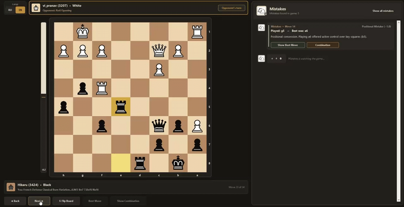

# ♟️ Chess_Analyzer - Chess studio for analyzing the latest game using an ML model




**Chess_Analyzer** is an application for automated analysis of chess games from Chess.com, combining the power of the **Stockfish** engine and a machine learning model (**Random Forest**).

Instead of dry computer evaluations, the built-in AI coach **Mistakes** explains errors in Russian or English, shows missed tactical combinations right on the board, and identifies played openings and gambits for both players.

<small style="opacity: 0.5;">Chess_Analyzer is a completely free open-source product (MIT License) created for educational purposes</small>

---

##  Key Features

* **AI Coach Mistakes:** Classifies errors into 5 categories (`blunder` - gross blunder, `hanging_piece` - piece en prise, `tactical_error` - missed tactic, `positional` - positional error, `inaccuracy` - inaccuracy), trained on a database of 162,000+ real positions.
* **Organic Dark Design & Classic Merida:** Smooth vector rendering of classic Merida pieces, an animated position evaluation scale (Eval Bar) to the left of the board, highlighting of threats, checks, and best moves.
* **Interactive Chat** All found errors are saved in the chat feed. Clicking on any card instantly jumps the board to the desired move and allows you to replay the move sequence of a missed combination or the opponent's refutation.
* **Bilingual Opening and Gambit Database:** Automatic recognition of the opening repertoire separately for White and Black.
* **Localization (RU / EN) and Board Flip:** Switching the interface and commentary language via a button in the top-left corner of the board area, as well as flipping the board `⇅`

---

## 🤝 Authors

> [!INFO] AI-Assisted Development
> The project was created with the assistance of artificial intelligence:
> * **Project Author and Developer:** [Bal7hasar-1](https://github.com/Bal7hasar-1) - idea, data collection, ML model training, pipeline architecture, and testing.
> * **Co-author (AI Collaborator):** **Gemini (Google AI)** - co-authoring code architecture design, developing the Merida vector piece renderer, creating the UI/UX interface, and writing documentation.

---

## ⚠️ Prerequisites: Downloading Stockfish

> [!IMPORTANT] Stockfish Chess Engine Required
> For the analyzer and dataset building scripts to work, **you must download the Stockfish engine in advance** (the executable file itself is not included in the repository due to size limits):
> 1. Go to the official website [stockfishchess.org/download](https://stockfishchess.org/download/).
> 2. Download the version for your operating system (for example, for Windows: `stockfish-windows-x86-64-avx2.exe` ).
> 3. Place the unpacked `.exe` file into the **`stockfish/`** folder inside the root of this project.
> *(If the file has a different name or is located elsewhere, a file explorer window will open on the first launch of `chess_gui.py`, where you can select your `stockfish.exe` manually).*

---

## 📋 Installation and Launch Instructions

### 1. Cloning the Repository
Open your terminal and download the project to your computer:
```bash
git clone [https://github.com/Bal7hasar-1/Chess_Analyzer.git](https://github.com/Bal7hasar-1/Chess_Analyzer.git)
cd Chess_Analyzer
```

### 2. Installing Dependencies
Make sure you have Python 3.9+ installed, and install the required libraries:
```bash
pip install -r requirements.txt
```

### 3. Configuring Your Credentials (Username and User-Agent)
According to Chess.com Public API rules, every request must contain a `User-Agent` header. For security reasons, this field is left empty in the code so that each user can specify their own details independently.

Before launching, specify your details in the following files:

<h3 align="center">MAIN</h3>

#### To launch the graphical interface - file `chess_gui.py` (lines 25 – 29):

- You can leave `USERNAME = ""` empty - then upon startup the program will ask for your username in a pop-up window, or you can enter your username right away.
- Be sure to fill in `USER_AGENT` (specify your username or email to identify requests on the Chess.com server):
```python
USERNAME = ""  # Leave empty for the input window or enter "Your_Username"
STOCKFISH_PATH = os.path.join(BASE_DIR, "stockfish", "stockfish-windows-x86-64-universal.exe")
MODEL_PATH = os.path.join(BASE_DIR, "models", "chess_error_model.joblib")
AVATAR_IMAGE_PATH = os.path.join(BASE_DIR, "assets", "images.jpg")
USER_AGENT = "ML-Chess-Analyzer/2.2 (user: Your_Username_or_Email)"
```


## Advanced (if you want to train your own model)

#### 1) For bulk downloading game archives - file `scripts/download_pgn.py`:
* On **line 11** inside the `fetch_chesscom_games` function, enter your `User-Agent`:
```python
headers = {
    "User-Agent": "ML-Chess-Analyzer/2.2 (user: Your_Username_or_Email)"
}
```
* On **lines 32–33**, specify the username of the player whose games you want to download, and the year:
```python
username = "Username"
year = 2026
```

#### 2) To extract errors from PGN - file `scripts/extract_errors.py`:
* On **line 11**, specify your username (used if `ANALYZE_ALL_PLAYERS = False`):
```python
USERNAME = "Your_Username"
```

### 4. Launching the Application
Once you have placed Stockfish into the `stockfish/` folder and specified your `User-Agent`, launch the studio with the command:
```bash
python chess_gui.py
```

---


## 📙 Custom Model Training and Recommendations

The repository already includes a pre-trained model (`models/chess_error_model.joblib`), but you can build your own dataset from scratch and retrain the classifier.
 
### 1. The scripts are run sequentially from the project root directory:

1. `python scripts/download_pgn.py` - downloads game archives of selected players into the `data/raw_pgn/` folder.
2. `python scripts/extract_errors.py` - analyzes downloaded games using the Stockfish engine, detects evaluation drops, and saves raw error data to `data/chess_errors_dataset.csv`.
3. `python scripts/build_features.py` - calculates physical and tactical board features (material changes, hanging pieces, mobility, checks) and generates the final table `data/chess_features_dataset.csv`.
4. `python scripts/train_chess_model.py` - trains the Random Forest algorithm on the engineered features (using an 80/20 train/test split) and saves the finalized model to `models/chess_error_model.joblib`.

### 2. Training and Saving the Model
The project uses a **Random Forest** (`scikit-learn`) algorithm that takes the engineered features from `data/chess_features_dataset.csv` and predicts one of the 5 error categories (`blunder`, `hanging_piece`, `tactical_error`, `positional`, `inaccuracy`). Once trained, the pipeline is serialized using `joblib` to `models/chess_error_model.joblib`, where `chess_gui.py` automatically loads it on startup.

### 💡 Training and Optimization Recommendations

* **Which chess games should be selected to train the model:** Since the model is specifically designed to classify mistakes, games from beginner and intermediate players (300 to 1600 Elo) are the most valuable for building a high-quality dataset. In grandmaster games, severe blunders (`blunder`) and hanging pieces (`hanging_piece`) are extremely rare, which would create a shortage of necessary training examples for the algorithm.

* **Class Balance:** In real games, minor inaccuracies (`inaccuracy`) and positional mistakes (`positional`) occur much more frequently than gross piece blunders (`hanging_piece`). When training your model, it is recommended to set `class_weight="balanced"` in `RandomForestClassifier` so the algorithm pays equal attention to rarer tactical error classes.

* **How a Model Understands Mistakes:  Centipawn Loss:** A small drop indicates an `inaccuracy`, while a massive drop (300+ points) signals a `blunder` or `tactical_error`.  **Material Balance:** Losing pieces without compensation is a clear marker of a tactical miscalculation. * **Attackers vs. Defenders:** Moving a piece to a square with more attackers than defenders perfectly triggers a `hanging_piece` classification.  **Mobility:** A sudden drop in available legal moves (e.g., a trapped piece) without material loss points to a `positional` error.

* **Dataset Size:** For reliable classification accuracy, aim to collect at least 30,000–60,000 labeled error positions (the default model included in this project was trained on 162,000+ positions).

> [!TIP] How to speed up game analysis in `extract_errors.py` by 4–10x
> Parsing thousands of PGN games with Stockfish is computationally intensive. By default, the engine uses only 1 CPU core and 16 MB of RAM. To significantly speed up dataset generation, open `scripts/extract_errors.py` and apply the following tweaks:
>
> **1. Allocate more CPU threads (`Threads`) and RAM for hash tables (`Hash`):**
> Right after the line `with chess.engine.SimpleEngine.popen_uci(STOCKFISH_PATH) as engine:`, add the resource configuration:
> ```python
> with chess.engine.SimpleEngine.popen_uci(STOCKFISH_PATH) as engine:
>     # Specify half/most of your CPU threads and 1024–2048 MB of RAM
>     engine.configure({"Threads": 6, "Hash": 2048})
> ```
>
> **2. Add a time limit per move:**
> Replace `engine.analyse(board, chess.engine.Limit(depth=ENGINE_DEPTH))` with a combined limit (for example, no longer than `0.1` seconds per position):
> ```python
> engine.analyse(board, chess.engine.Limit(depth=ENGINE_DEPTH, time=0.1))
> ```
>
> **3. Skip early opening book moves:**
> In the game move parsing loop, skip the first 8–10 half-moves (`if ply < 10: continue`) to avoid wasting CPU time on standard opening theory.
## 📂 Project Structure

```text
Chess_Analyzer/
├── assets/
│   └── images.jpg                 # Icon/avatar of the Mistakes coach
├── data/
│   └── raw_pgn/                   # Folder for downloaded PGN game archives
├── models/
│   └── chess_error_model.joblib   # Trained model (Pipeline + Random Forest)
├── scripts/
│   ├── download_pgn.py            # Script for downloading games via Chess.com API
│   ├── extract_errors.py          # Finding errors in games using Stockfish
│   ├── build_features.py          # Feature generation for ML model training
│   ├──train_chess_model.py 
├── stockfish/                     # Folder for the Stockfish engine executable (.exe)
├── chess_gui.py                   # Main GUI application
├── requirements.txt               # List of required Python libraries
└── README.md                      # Project documentation
```

---

## 📄 License
This project is distributed under the **MIT License**. You are free to use, modify, and distribute the code.
