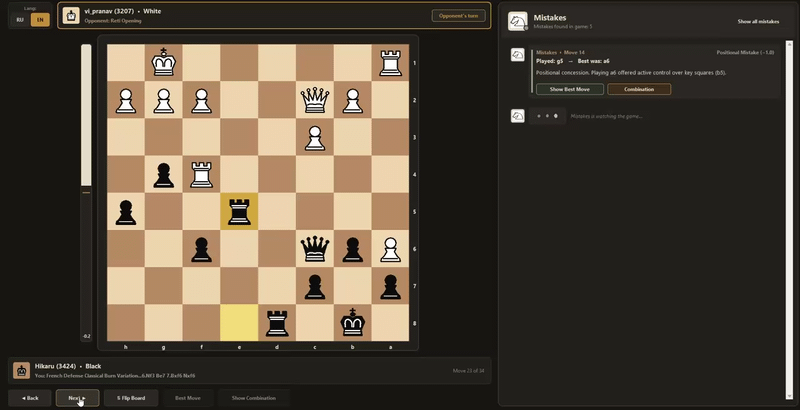

# ♟️ Chess_Analyzer - Шахматная студия для анализа последней игры при помощи ML-модель




**Chess_Analyzer** - это приложение для автоматического разбора шахматных партий с платформы Chess.com, объединяющее мощь движка **Stockfish** и модель машинного обучения (**Random Forest**).

Вместо сухих компьютерных оценок модель объясняет ошибки на русском или английском языке, показывает упущенные тактические комбинации прямо на доске и определяет разыгранные дебюты и гамбиты для обоих игроков.

<small style="opacity: 0.5;">Chess_Analyzer - это полностью бесплатный продукт с открытым исходным кодом (MIT License), созданный для образовательных целей</small>

---

##  Основные возможности

* **ИИ-тренер Mistakes:** Классифицирует ошибки на 5 категорий (`blunder` - грубый зевок, `hanging_piece` - фигура под боем, `tactical_error` - упущенная тактика, `positional` - позиционная ошибка, `inaccuracy` - неточность), обучившись на базе из 162 000+ реальных позиций.
* **Дизайн Organic Dark & Классика Merida:** Плавная векторная отрисовка классических фигур Merida, анимированная шкала оценки позиции (Eval Bar) слева от доски, подсветка угроз, шахов и лучших ходов.
* **Интерактивный чат** Все найденные ошибки сохраняются в ленте чата. Клик по любой карточке мгновенно переносит доску к нужному ходу и позволяет воспроизвести серию ходов упущенной комбинации или опровержения соперника.
* **Двуязычная база дебютов и гамбитов:** Автоматическое распознавание дебютного репертуара отдельно для Белых и Чёрных.
* **Локализация (RU / EN) и разворот доски:** Переключение языка интерфейса и комментариев кнопкой в левом верхнем углу зоны доски, а также разворот доски `⇅`

---

## 🤝 Авторы

> [!INFO] AI-Assisted Development
> Проект создан при помощи искусственного интеллекта:
> * **Автор и разработчик проекта:** [Bal7hasar-1](https://github.com/Bal7hasar-1) - идея, сбор данных, обучение ML-модели, архитектура конвейера и тестирование.
> * **Соавтор (AI Collaborator):** **Gemini (Google AI)** - соавторство в проектировании архитектуры кода, разработке векторного рендерера фигур Merida, создании UI/UX интерфейса и написании документации.

---

## ⚠️ Предварительные требования: Скачивание Stockfish

> [!IMPORTANT] Необходим шахматный движок Stockfish
> Для работы анализатора и скриптов сборки датасета **необходимо заранее скачать движок Stockfish** (сам исполняемый файл не включён в репозиторий из-за ограничений размера):
> 1. Перейдите на официальный сайт [stockfishchess.org/download](https://stockfishchess.org/download/).
> 2. Скачайте версию для вашей операционной системы (например, для Windows: `stockfish-windows-x86-64-avx2.exe` ).
> 3. Поместите распакованный файл `.exe` в папку **`stockfish/`** внутри корня этого проекта.
> *(Если файл называется иначе или лежит в другом месте, при первом запуске `chess_gui.py` откроется окно проводника, где вы сможете выбрать ваш `stockfish.exe` вручную).*

---

## 📋 Инструкция по установке и запуску

### 1. Клонирование репозитория
Откройте терминал и скачайте проект на свой компьютер:
```bash
git clone https://github.com/Bal7hasar-1/Chess_Analyzer.git
cd Chess_Analyzer
```

### 2. Установка зависимостей
Убедитесь, что у вас установлен Python 3.9+, и установите необходимые библиотеки:
```bash
pip install -r requirements.txt
```

### 3. Настройка своих данных (Никнейм и User-Agent)
По правилам публичного API Chess.com каждый запрос должен содержать заголовок `User-Agent`. В целях безопасности в коде это поле оставлено пустым, чтобы каждый пользователь указывал свои данные самостоятельно.

Перед запуском укажите свои данные в следующих файлах:

<h3 align="center">ОСНОВНОЕ</h3>
####  Для запуска графического интерфейса - файл `chess_gui.py` (строки 25 – 29):

* Вы можете оставить `USERNAME = ""` пустым - тогда при запуске программа сама спросит ваш никнейм во всплывающем окне, либо вписать свой ник сразу.
* Обязательно заполните `USER_AGENT` (укажите свой никнейм или почту для идентификации запросов на сервере Chess.com):
```python
USERNAME = ""  # Оставьте пустым для окна ввода или впишите "Ваш_Никнейм"
STOCKFISH_PATH = os.path.join(BASE_DIR, "stockfish", "stockfish-windows-x86-64-universal.exe")
MODEL_PATH = os.path.join(BASE_DIR, "models", "chess_error_model.joblib")
AVATAR_IMAGE_PATH = os.path.join(BASE_DIR, "assets", "images.jpg")
USER_AGENT = "ML-Chess-Analyzer/2.2 (user: Ваш_Никнейм_или_Email)"
```


## Дополнительно (если вы захотите обучить свою модель)


#### 1) Для  скачивания архивов партий - файл `scripts/download_pgn.py`:
* На **строке 11** внутри функции `fetch_chesscom_games` впишите свой `User-Agent`:
```python
headers = {
    "User-Agent": "ML-Chess-Analyzer/2.2 (user: Ваш_Никнейм_или_Email)"
}
```
* На **строках 32–33** укажите никнейм игрока, чьи партии хотите скачать, и год:
```python
username = "Никнейм"
year = 2026
```

#### 2) Для извлечения ошибок из PGN - файл `scripts/extract_errors.py`:
* На **строке 11** укажите свой никнейм (используется, если `ANALYZE_ALL_PLAYERS = False`):
```python
USERNAME = "Ваш_Никнейм"
```

### 4. Запуск приложения
После того как вы поместили Stockfish в папку `stockfish/` и указали `User-Agent`, запустите студию командой:
```bash
python chess_gui.py
```

---
## 📙 Самостоятельное обучение модели и рекомендации

В репозитории уже находится готовая обученная модель (`models/chess_error_model.joblib`), однако вы можете собрать собственный датасет с нуля и переобучить модель 

### 1. В каком порядке запускать файлы

1. `python scripts/download_pgn.py` - скачивает архивы партий выбранных игроков в папку `data/raw_pgn/`.
2. `python scripts/extract_errors.py` - прогоняет скачанные партии через движок Stockfish, находит потери оценки и сохраняет базовые данные об ошибках в `data/chess_errors_dataset.csv`.
3. `python scripts/build_features.py` - вычисляет физические и тактические признаки позиции (изменение материала, наличие фигур под боем, мобильность, шахи) и формирует финальную таблицу `data/chess_features_dataset.csv`.
4. `python scripts/train_chess_model.py` - обучает алгоритм Random Forest на собранных признаках (с разделением 80% на обучение и 20% на тест) и сохраняет новую модель в `models/chess_error_model.joblib`.

### 2. Обучение и сохранение модели
Для обучения используется алгоритм **Random Forest** (`scikit-learn`), который принимает сгенерированные признаки из `data/chess_features_dataset.csv` и предсказывает одну из 5 категорий ошибок (`blunder`, `hanging_piece`, `tactical_error`, `positional`, `inaccuracy`). После обучения пайплайн сохраняется с помощью библиотеки `joblib` по пути `models/chess_error_model.joblib`, откуда его автоматически подгружает `chess_gui.py`.

### 💡 Рекомендации по обучению и оптимизации

* **Какой материал стоит выбрать:** Поскольку модель специализируется на классификации ошибок, для сбора качественного датасета лучше всего использовать партии игроков начального и среднего уровня (от 300 до 1600 Elo). Так как в играх гроссмейстеров грубые зевки (`blunder`) и оставленные под боем фигуры (`hanging_piece`) встречаются крайне редко, из-за чего алгоритму просто не на чем будет учиться. 
 
* **Баланс классов:** В реальных партиях лёгкие неточности (`inaccuracy`) и позиционные ошибки (`positional`) встречаются гораздо чаще, чем грубые зевки фигур (`hanging_piece`). При обучении модели рекомендуется использовать параметр `class_weight="balanced"` в `RandomForestClassifier`, чтобы алгоритм не игнорировал редкие категории ошибок.

* **Как модель понимает ошибки**: **Падение оценки (Centipawn Loss):** Небольшое - это неточность (`inaccuracy`), резкое (от 300+ пунктов) - грубый зевок (`blunder`) или тактика (`tactical_error`).  **Баланс материала:** Потеря фигур без компенсации - чёткий маркер тактического просчёта.  **Атака и защита:** Если вражеских фигур, бьющих поле, больше, чем ваших защитников, модель фиксирует оставление фигуры под боем (`hanging_piece`).  **Мобильность:** Резкое сокращение доступных ходов (например, запертая фигура) без потери материала указывает на позиционную ошибку (`positional`).

* **Объём данных:** Для стабильной работы классификатора рекомендуется собрать минимум 20 000-40 000 размеченных позиций с ошибками (базовая модель проекта обучена на 162 000+ позиций).

> [!TIP] Как ускорить разбор партий в `extract_errors.py` в 4–10 раз
> Анализ тысяч PGN-партий движком Stockfish требует больших вычислительных ресурсов. По умолчанию движок задействует всего 1 ядро ЦП и 16 МБ ОЗУ. Чтобы ускорить сбор датасета, откройте `scripts/extract_errors.py` и внесите следующие правки:
>
> **1. Выделите больше потоков процессора (`Threads`) и оперативной памяти (`Hash`):**
> Сразу после строки `with chess.engine.SimpleEngine.popen_uci(STOCKFISH_PATH) as engine:` добавьте конфигурацию:
> ```python
> with chess.engine.SimpleEngine.popen_uci(STOCKFISH_PATH) as engine:
>     # Укажите половину/большую часть потоков вашего ЦП и 1024–2048 МБ ОЗУ
>     engine.configure({"Threads": 6, "Hash": 2048})
> ```
>
> **2. Ограничьте время расчёта на один ход:**
> Замените `engine.analyse(board, chess.engine.Limit(depth=ENGINE_DEPTH))` на комбинированный лимит (например, не более `0.1` секунды на ход):
> ```python
> engine.analyse(board, chess.engine.Limit(depth=ENGINE_DEPTH, time=0.1))
> ```
>
> **3. Пропускайте дебютную теорию:**
> Добавьте в цикл разбора партии пропуск первых 8-10 полуходов (`if ply < 10: continue`), чтобы не тратить ресурсы процессора на стандартные книжные ходы.
## 📂 Структура проекта

```text
Chess_Analyzer/
├── assets/
│   └── images.jpg                 # Иконка/аватар тренера Mistakes
├── data/
│   └── raw_pgn/                   # Папка для скачанных PGN-архивов партий
├── models/
│   └── chess_error_model.joblib   # Обученная модель (Pipeline + Random Forest)
├── scripts/
│   ├── download_pgn.py            # Скрипт скачивания партий через API Chess.com
│   ├── extract_errors.py          # Поиск ошибок в партиях с помощью Stockfish
│   ├── build_features.py          # Генерация признаков для обучения ML-модели
│   ├──train_chess_model.py        # Обучение модели 
├── stockfish/                     # Папка для исполняемого файла движка Stockfish (.exe)
├── chess_gui.py                   # Главное графическое приложение
├── requirements.txt               # Список необходимых библиотек Python
└── README.md                      # Документация проекта
```

---

## 📄 Лицензия
Проект распространяется под лицензией **MIT License**. Вы можете свободно использовать, модифицировать и распространять код.